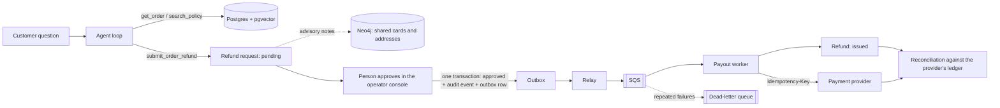

# Agent harness for financial operations

**An agent harness, built from scratch, for LLM agents that can move money.**

Once a model can trigger a refund, a lot can go wrong. It can pay the same order twice, pay out of another merchant's
account, pay before anyone has approved it, or pay and then crash before recording that it did. This harness handles
each of those in code, and each one has a test. No agent framework: the loop, the tool layer and everything after the
model's decision are written here.

**Components**

- **Agent loop.** Works with the OpenAI Responses API, with Claude, or with a fake model in tests. Tool arguments are
  validated with Pydantic. Unknown tools, invalid arguments and tool exceptions are returned to the model as tool
  results. A run stops after a fixed number of steps.
- **Scoping and permissions.** The merchant comes from the request and is fixed when the tools are built; it is not a
  tool argument. Eligibility rules are checked in code inside the database transaction. The model has no tool for
  approving or paying.
- **Approval.** Requests wait for a reviewer, who approves or rejects them. Approving writes the status change, an
  audit event and the payout job in one transaction.
- **Payouts.** A transactional outbox feeds an SQS queue with a dead-letter queue. The worker calls the payment
  provider with an idempotency key, so a retry after a crash does not pay twice.
- **Reconciliation.** Our refunds are compared line by line with the provider's payouts.
- **Retrieval and risk notes.** Policy search with pgvector and a distance cutoff. A Neo4j graph of customers who
  share a card or an address; reviewers see which customers are linked and through which card or address.
- **Evals and observability.** Hand-labelled eval cases scored in code; OpenTelemetry traces with token counts and
  cost; Sentry; Prometheus and Grafana; an operator console in Next.js.

Refunds are the example domain. The loop and tool registry in `agent/` don't refer to it; see
[Beyond refunds](#beyond-refunds).

353 tests, run against real Postgres, Neo4j, Redis and SQS in Docker; none of them call a model or the network.

## One refund, end to end



The model has three tools: `get_order`, `search_policy` and `submit_order_refund`. Submitting creates a pending
request; eligibility (no more than the order total, delivered, within 30 days) is checked in code in the same
transaction. The merchant is set by the harness from the request. Approving, paying and the linked-account notes are
outside the model's reach.

## What can go wrong, and what stops it

| Failure | What prevents it | Proven by (in `tests/`) |
|---|---|---|
| The same order refunded twice (asked twice, or two requests at once) | A partial unique index allows one live refund per order; the order row is locked (`FOR UPDATE`) while checking | `test_simultaneous_submissions_make_one_refund` |
| The model reads or acts on another merchant's data | The merchant is bound when the tools are built; another merchant's order looks exactly like a missing one | `test_model_cannot_choose_the_merchant`, `test_other_merchants_order_looks_missing` |
| The model approves or pays out | There is no tool for it. Approval is a separate endpoint that records who approved | `test_model_has_no_tool_to_approve_or_pay` |
| Approved, but the payout job is lost (crash between commit and enqueue) | Transactional outbox: the approval, its audit event and the payout job commit together; a relay sends them at least once | `test_failed_approval_leaves_nothing_behind` |
| The worker dies after the provider pays but before recording it, so the retry pays again | Each payout carries an idempotency key derived from the refund; the provider returns the first payout instead of making a second | `test_retry_after_a_crash_pays_once`, `test_two_workers_at_once_pay_once` |
| The provider is down, or a message is malformed | Retries with growing backoff, then the dead-letter queue (with an alert and a redrive script) | `test_repeated_failure_goes_to_dead_letters` |
| Something gets past all of the above | Reconciliation compares our records with the provider's ledger line by line (below) | `test_reconcile.py` |
| A ring of accounts sharing cards or addresses farms refunds | Neo4j finds linked customers and attaches notes for the approver. The notes never block a refund and are never shown to the model; if Neo4j is down, the approver is told the check did not run | `test_notes_go_to_the_approver_never_the_model`, `test_neo4j_down_still_creates_the_refund` |
| The model guesses a policy that doesn't exist | Policy matches beyond a measured distance cutoff are dropped, and the model is told not to guess | `test_model_is_told_not_to_guess` |
| A runaway loop, an invented tool name, bad arguments | Step limit; unknown tools and Pydantic validation errors go back to the model as tool results | `test_loop.py` |
| One merchant floods the agent (and the model bill) | A per-merchant rate limit in Redis; if Redis is down, requests are still served without the limit | `test_rate_limit.py` |

## Reconciliation

Every payout uses its refund's key as the provider's reference, so the two ledgers line up key by key. Each line is in
one of seven states, and the operator console's Ledger page shows the exceptions:

| State | Meaning |
|---|---|
| `matched` | Issued here, paid exactly once there, same amount |
| `awaiting_payout` | Approved here, not paid yet: the job is on its way |
| `paid_not_recorded` | Paid there, still "approved" here: a worker died mid-way. The retried job records it (and pays nothing new) |
| `missing_at_provider` | "Issued" here, but no payout there: money we think went out never did |
| `duplicate_payout` | More than one payout for one refund |
| `amount_mismatch` | Paid once, but not the amount that was approved |
| `unknown_payout` | A payout under this merchant's references that matches no refund of ours |

## Seeing what the agent did

- **Traces.** Every request is an OpenTelemetry trace using the GenAI conventions: agent run, then each model call
  (tokens, cost) and each tool call. Tool crashes go to Sentry. Prompt and response content is recorded only when
  enabled.
- **Cost.** Computed from token counts and published prices per model, because one provider's own cost figure ignored
  which model was used.
- **Metrics and alerts.** Prometheus plus a Grafana dashboard. Alerts fire when a process is down, payouts reach the
  dead-letter queue, payout jobs wait too long, the server error rate is high, or model spend is high.
- **Operator console** (Next.js, in `frontend/`): Overview (the whole pipeline with live counts); Agent (every model and tool call of a run, with time,
  tokens and cost); Approvals (queue, linked-account notes, audit trail); Ledger (reconciliation); Architecture (each part with a link to
  its source, and the design decisions); Quality (evals and
  load test results).

## Measured

### The model

31 hand-labelled eval cases, scored by code: was the right tool called, does the database end up in the right state,
was the right policy found (hit@k), are required words present and forbidden ones absent. An LLM judge for answer quality also exists. The
Claude rows are one run per case, so differences of a few points are noise.

| Model | Pass rate | Mean latency per case | Cost per case |
|---|---|---|---|
| gpt-6-luna, low reasoning (OpenAI API, the default; 3 runs per case) | 99% (92/93) | 3.6 s | ~$0.0001 |
| Claude Sonnet 5.5 (via the CLI) | 97% | 16.7 s | ~$0.03 |
| Claude Haiku 5.5 (via the CLI) | 94% | 11.3 s | ~$0.002 |

What the evals caught: gpt-6-luna scored 31/31 on a single run, but repeating one case 6 times showed it skipped the
policy search half the time on a vague question. One sentence in its instructions fixed that (6/6). Earlier, the evals
caught my own regression: replacing the Claude CLI's system prompt broke its structured output and dropped the pass
rate to 48%.

### Load on one API process

k6 ramping virtual users against `/refund-agent/ask`, with a stand-in model (1 s per call, 2 calls per ask, so 2 s is
the floor). One uvicorn process; everything else local in Docker.

| Users at peak | Asks per second (whole run) | p95 latency | Errors | API CPU at peak |
|---|---|---|---|---|
| 500 | 82 | 2.14 s | 0% | 75% of one core |
| 1,500 | 168 | 5.08 s | 0% | 95-99% of one core |

The limit is one CPU core: the event loop runs on one core, so beyond ~250-300 asks/s requests queue and latency
climbs, but nothing fails. The fix is more processes. With a real model, the provider's rate limits are hit first.
The worker scales on a different signal: how long jobs wait on the queue (`payout_job_wait_seconds`).

### Graph versus SQL for "who is linked to this customer?"

50,000 synthetic customers sharing cards and addresses; median of 6 random start customers, in milliseconds. All four
methods return identical answers.

| Steps | Customers reached | SQL joining `orders` | SQL over a links table | Cypher, all trails | Cypher, ANY SHORTEST |
|---|---|---|---|---|---|
| 4 | 1,582 | 17 | 11 | 5 | 12 |
| 5 | 7,402 | 73 | 48 | 11 | 52 |
| 6 | 26,830 | 307 | 201 | 30 | 260 |
| 7 | 47,787 | 1,181 | 706 | 67 | 1,358 |

Up to three steps, indexed SQL is just as fast. The gap opens with depth and density. In exchange, the graph is a copy
that has to be loaded (12-20 s for 50,000 customers) and kept in sync with Postgres, which remains the source of truth.

### Embedding cache

A Gemini embedding call took 674 ms; the same question from Redis took 0.5 ms. Only the question's vector is cached
(keyed by model and text, never by merchant). The policy search that follows is never cached and is always filtered by
merchant.

## Beyond refunds

The core in `agent/` (loop, tool registry, model interface, pricing) is under 400 lines and has no refund-specific
code. The same flow (the agent files a request, code checks it, a person approves, a worker carries it out, the result
is reconciled) applies to other finance workflows. Accounts payable is the closest match:

| Here | In accounts payable |
|---|---|
| One live refund per order, idempotency keys | Duplicate invoice and duplicate payment prevention |
| Human approval with an audit trail | Approval workflows, an audit trail for the close |
| Policy retrieval with a distance cutoff | Vendor terms and expense policy lookup that admits when it doesn't know |
| Linked accounts through shared cards and addresses | Duplicate vendors, vendors sharing bank details or addresses |
| Outbox, queue, idempotent worker | Payment runs that survive crashes |
| Reconciliation against the provider's ledger | Bank reconciliation |

Moving to a new workflow means new tools, schema, eval cases and a new provider client. The loop, observability, eval
machinery, queue and reconciliation pattern stay the same.

## Known limits

- **The payment provider is a stand-in**: a separate process with an in-memory ledger that honours `Idempotency-Key`
  the way real providers do.
- **Auth is a stand-in**: the merchant and reviewer come from `X-Merchant-Id` / `X-Reviewer-Id` headers, with an
  optional bearer key in front. In production they would come from a verified token. They are still never taken from
  the request body or from the model.
- **The LLM judge has not been checked against human labels**, so the code checks are the trusted signal.
- **One global eligibility policy** (30 days), not per merchant.
- **The graph lags Postgres** until the next sync, and the linked-account notes reflect the graph as it was then.
- **Runs locally in Docker**; CI and deployment are not set up yet.

## Running it

`docker compose` provides Postgres (pgvector), Neo4j, Redis, SQS (ElasticMQ), Prometheus and Grafana. Put secrets in
`.env` (git-ignored; `.env.example` lists them): `OPENAI_API_KEY`, `GEMINI_API_KEY`, and optionally `SENTRY_DSN` and `LANGFUSE_*`.

```
docker compose --profile app up -d --build   # everything, including the API (:8000), worker and fake provider
uv run python scripts/seed_demo.py           # demo data for the console (empties the refund tables); the console's
                                             # "Reset demo data" button does the same
cd frontend && npm install && npm run dev     # operator console on http://localhost:3001; Grafana is on :3000
```

Or run the infrastructure in Docker and the Python on your machine:

```
docker compose up -d
scripts/create_test_db.sh                                          # once, and after schema changes: the tests' database
uv run pytest -q                                                   # the tests: no network, no tokens
uv run --env-file .env uvicorn refund_harness.app:app --reload     # the API; docs at /docs; each request prints its trace
uv run python scripts/run_worker.py                                # outbox relay + payout worker (metrics on :9101)
uv run --env-file .env python scripts/run_evals.py                 # the evals (--langfuse stores them as an experiment)
```

Failure drills:

```
uv run python scripts/run_worker.py --crash-after-payout   # dies right after the provider pays; restart it: nothing is paid twice
uv run python scripts/queues.py                            # what is on the queues and the dead-letter queue (--redrive)
```

Load test: start the API with `LLM_PROVIDER=fake TRACING=off ASK_RATE_LIMIT=1000000`, then
`docker run --rm -i --add-host=host.docker.internal:host-gateway grafana/k6:2.3.0 run - < load/ask.js`.

`db/init/` runs only on a fresh Postgres volume; apply later files by hand to an existing one.

## Layout

```
src/refund_harness/
  agent/        the harness core, provider- and domain-neutral: loop, tools, types, model interface, pricing, errors
  adapters/     model and embedding providers: OpenAI Responses, Claude CLI, Gemini embeddings; factory picks one
  refund_tools.py  the agent's tools for this domain, built per request for one merchant
  app.py        FastAPI: ask the agent, approval, operator endpoints (refunds, ledger, summary), /metrics
  data/         Postgres: connection pool and all SQL
  retrieval/    embedding policy text for vector search
  graph/        Neo4j: sync from Postgres, linked-account notes, graph-versus-SQL benchmark
  payments/     provider client, idempotent payout, reconciliation; fake_provider.py is the stand-in provider
  jobs/         outbox relay, SQS queues and dead-letter queue, payout worker
  cache/        Redis: embedding cache, per-merchant rate limit (both keep working when Redis is down)
  evals/        cases, runner, code scorers, LLM judge, reports, Langfuse sink
  observability.py, metrics.py   traces, Sentry, Prometheus
frontend/       operator console (Next.js, TypeScript)
monitoring/     Prometheus scrape config, alert rules, Grafana dashboard
evals/cases.yaml  the hand-labelled eval cases
db/init/        schema and seed data
scripts/        try it, evals, ingestion, graph sync and benchmark, worker, queue tools, demo data
tests/          one file per topic
```
