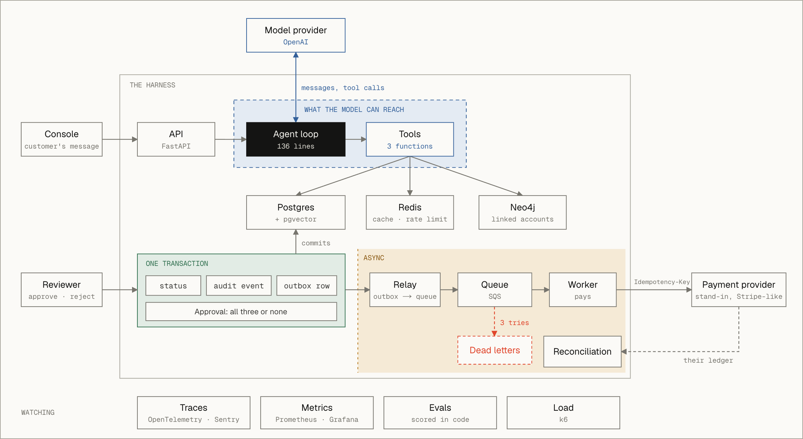

# Agent harness for financial operations

A fully custom harness for LLM agents dealing with finances and refund requests. Here it runs customer refunds for two online stores: an agent answers customers and files refund requests, a person approves them, a worker pays them out, and every payout is checked against the payment provider's records.

Once a model can trigger a payment, the real risks are outside the conversation: paying the same order twice, paying from another merchant's account, paying without approval, or paying and crashing before recording it. Each of those is handled in code, and each has a test that makes it happen.

**Stack:** Python, FastAPI, Postgres with pgvector, Neo4j, Redis, SQS, OpenTelemetry, Sentry, Prometheus and Grafana, and a Next.js console.

## How it works



- **The model can only file a request.** It has three tools: look up an order, search the merchant's policy, and submit a refund request. There is no tool to approve or pay, and the merchant is fixed by the harness, never passed by the model.
- **Code checks every request.** The amount, the delivery, the 30-day window and "one live refund per order" are enforced inside the database transaction, whatever the customer told the model.
- **A person approves.** The reviewer sees the customer's history and any accounts that share their card or address. Those notes come from a graph, are advisory, and are never shown to the model. The approval, its audit event and the payout job are written together or not at all.
- **The payout happens once.** A worker takes the job from a queue and pays with a key named after the refund, so a retry after a crash gets the first payout back instead of making a second. Jobs that keep failing move to a dead-letter queue and raise an alert.
- **The records are reconciled.** Every payout is matched with the provider's ledger, and anything paid twice, never paid or paid the wrong amount is flagged.

## What can go wrong, and what stops it

| Failure | What stops it | Test |
|---|---|---|
| The same order refunded twice | One live request per order (a unique index); the order is locked while it is checked | `test_simultaneous_submissions_make_one_refund` |
| The model acts for another merchant | The merchant is bound when the tools are built; another merchant's order looks like a missing one | `test_model_cannot_choose_the_merchant` |
| The model approves or pays | There is no tool for either | `test_model_has_no_tool_to_approve_or_pay` |
| Approved, but the payout job is lost | The job is written in the approval's transaction (an outbox) | `test_failed_approval_leaves_nothing_behind` |
| The worker crashes after the provider paid | The retry sends the same idempotency key and gets the first payout back | `test_crash_after_paying_never_pays_twice` |
| The provider is down, or a job is malformed | Retries with backoff, then the dead-letter queue and an alert | `test_repeated_failure_goes_to_dead_letters` |
| A payout made outside the system | Reconciliation against the provider's ledger | `test_reconcile.py` |
| Accounts sharing a card farm refunds | Linked-account notes for the reviewer | `test_notes_go_to_the_approver_never_the_model` |
| The model makes up a policy | Weak policy matches are dropped and the model is told not to guess | `test_model_is_told_not_to_guess` |
| One merchant floods the agent | A rate limit per merchant | `test_one_merchant_cannot_block_another` |

353 tests, run against real Postgres, Neo4j, Redis and SQS; none of them call a model.

## Measured

Evals: 31 hand-labelled cases run through the real harness and scored in code (were the right tools called, is the database in the right state, was the right policy found, are forbidden claims absent).

| Model | Passed | Mean time | Cost per question |
|---|---|---|---|
| gpt-6-luna, low reasoning (the default; 3 runs per case) | 92 of 93 (99%) | 3.6 s | $0.0001 |
| Claude Sonnet 5.5, through the Claude CLI | 30 of 31 (97%) | 16.7 s | $0.03 |
| Claude Haiku 5.5, through the Claude CLI | 29 of 31 (94%) | 11.3 s | $0.002 |

- **What the evals caught.** The default model skipped the policy search on a vague question in 3 of 6 repeats. One sentence in its instructions fixed it (6 of 6).
- **Load.** One API process, with a stand-in model so the harness is what gets measured, served 1,500 simulated customers at a p95 of 5.1 s with no errors. The limit is one CPU core, so it scales by adding processes.
- **Graph or SQL.** For "who is linked to this customer", indexed SQL is as fast up to three steps. At seven steps (47,787 of 50,000 customers reached) the graph answers in 67 ms and the best SQL in 706 ms.
- **Embedding cache.** A repeated question takes 0.5 ms instead of a 674 ms embeddings call.

Every request is also an OpenTelemetry trace (each model call with its tokens and cost, each tool call), errors go to Sentry, and Prometheus alert rules watch for dead letters, stuck payouts, the error rate and model spend.

## Beyond refunds

The core in `agent/` (the loop, tool registry, model interface and pricing) is under 400 lines and knows nothing about refunds. The same flow, in which the agent files, code checks, a person approves, a worker executes and the result is reconciled, fits other finance work. Accounts payable is the closest:

| Here | In accounts payable |
|---|---|
| One live refund per order, idempotency keys | Duplicate invoice and duplicate payment prevention |
| Approval with an audit trail | Approval workflows, an audit trail for the close |
| Policy search that admits when nothing matches | Vendor terms and expense policy lookup |
| Accounts sharing cards and addresses | Duplicate vendors, vendors sharing bank details |
| Reconciliation against the provider's ledger | Bank reconciliation |

A new workflow needs new tools, schema, eval cases and a provider client; the loop, tracing, evals, queue and reconciliation stay.

## Known limits

- The payment provider is a stand-in: its own process with an in-memory ledger that honours idempotency keys the way real providers do.
- Sign-in is a stand-in: the merchant and reviewer come from request headers behind an API key. They are never taken from the request body or from the model.
- The LLM judge has not been checked against human labels, so the code-scored checks are the trusted signal.
- One eligibility policy (30 days) for every merchant.
- The graph is a copy of Postgres that lags until its next sync; Postgres is the source of truth.
- One server, and no CI yet.

## Running it

Secrets go in `.env` (`.env.example` lists them).

```
docker compose --profile app up -d --build    # everything: databases, queue, API (:8000), worker, stand-in provider
uv run python scripts/seed_demo.py            # the demo data
cd frontend && npm install && npm run dev      # the console on http://localhost:3001; Grafana is on :3000

scripts/create_test_db.sh && uv run pytest -q                 # the tests, on their own database
uv run --env-file .env python scripts/run_evals.py            # the evals
uv run python scripts/run_worker.py --crash-after-payout      # crash drill: restart it, and nothing is paid twice
```

Deployed, everything runs on one server with Docker Compose behind Caddy for HTTPS (`deploy/setup.sh`), and the console runs on Vercel.

## Layout

```
src/refund_harness/
  agent/          the core: loop, tools, model interface, pricing (no refund-specific code)
  adapters/       OpenAI, Claude and Gemini embeddings
  refund_tools.py the agent's tools for refunds, built per request for one merchant
  app.py          the API
  data/           every SQL query
  graph/          the Neo4j copy, linked-account notes, the graph-or-SQL benchmark
  payments/       payouts, reconciliation, the stand-in provider
  jobs/           outbox relay, queue, worker
  evals/          cases, runner, scorers, judge, reports
frontend/         the console
tests/            one file per topic
```
